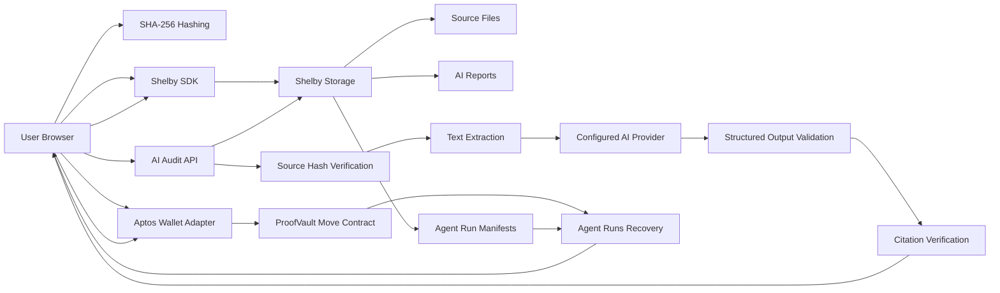
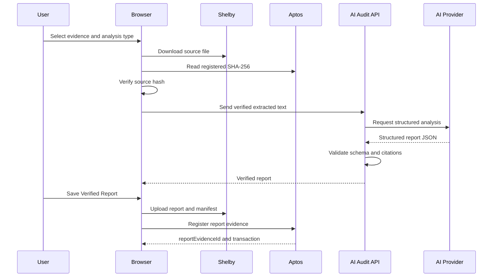

# ProofVault

ProofVault is a verifiable storage and AI audit platform built on Shelby and Aptos. Users can store documents, datasets, media, and digital records on Shelby, register their integrity hashes on Aptos, and run AI-powered audits whose sources, citations, reports, and execution manifests remain independently verifiable.

## Table of Contents
- [Problem Statement](#problem-statement)
- [Solution](#solution)
- [Architecture](#architecture)
- [Features](#features)
  - [Verifiable Storage](#verifiable-storage)
  - [ProofVault AI Auditor](#proofvault-ai-auditor)
  - [Citation Verification](#citation-verification)
  - [Agent Runs & Source of Truth](#agent-runs--source-of-truth)
  - [Failure Recovery & Pagination](#failure-recovery--pagination)
  - [Binary & Corrupt Protection](#binary--corrupt-protection)
- [Upload Sequence](#upload-sequence)
- [AI Audit Sequence](#ai-audit-sequence)
- [Setup & Deployment](#setup--deployment)
  - [Environment Variables](#environment-variables)
  - [Local Setup](#local-setup)
  - [Railway Deployment](#railway-deployment)
- [Production E2E Checklist](#production-e2e-checklist)
- [Security](#security)
- [Current Limitations](#current-limitations)

---

## Problem Statement

Traditional file storage cannot prove that a document remained unchanged after publication. AI-generated analysis introduces an additional trust problem: users often cannot verify which source files were used, whether citations are genuine, or whether the generated report was modified afterward. AI output is prone to hallucinations, leaving users guessing if a claim is accurate.

## Solution

ProofVault stores original files and AI-generated reports on Shelby while registering their hashes, publishers, timestamps, and storage references on Aptos. 

Before an AI audit begins, ProofVault downloads the source file from Shelby and verifies its SHA-256 hash against the Aptos record. AI findings are returned as structured data, and every citation is independently checked against the extracted source text. Unsupported findings are removed. The approved report and its execution manifest are then stored back on Shelby, while the final report hash is anchored on Aptos, creating a verifiable chain from source document to AI output.

---

## Architecture



---

## Features

### Verifiable Storage
- Upload documents, datasets, media and digital records.
- SHA-256 hashing in browser.
- Shelby Testnet storage.
- Aptos Move registry.
- Download and local file verification.
- Shelby Explorer links.
- Public archive and searchable evidence records.

### ProofVault AI Auditor
- **Document Summary**: Executive summary, key facts, dates, action items, risks, and unresolved questions.
- **Consistency Audit**: Check for conflicting dates, mismatched amounts, inconsistent names, missing information, and contradictions.
- **Document Comparison**: Compare additions, removals, changed clauses, and major differences (Requires 2 files).
- Source hash verification before analysis.
- Structured AI output.
- Server-side API key protection.
- Save Verified Report directly to Shelby and Aptos.

### Citation Verification
To prevent AI hallucinations, ProofVault implements strict citation verification:
- AI output must pass schema validation.
- `citation.fileName` must belong to the verified source files.
- `citation.excerpt` must exist verbatim in the extracted source text (with whitespace normalization).
- AI-generated paraphrases are rejected.
- Unsupported citations and findings without valid citations are removed.
- *Disclaimer*: AI-generated findings may be incomplete or incorrect. Always review the cited source files.

### Agent Runs & Source of Truth
**Aptos and Shelby are the source of truth. `localStorage` is used only as a temporary cache.**
- Aptos stores the evidence ID, publisher, hash, and metadata.
- Shelby stores the original files, reports (`audit-report.json`), and the execution manifests (`agent-run-manifest.json`).
- If you clear your browser cache or change devices, connecting the same wallet and syncing will fully recover your Agent Runs history.
- The system does not use `totalEvidenceCount` to blindly guess IDs; it parses `manifestBlobId` from the Aptos event description.

#### Agent Run Manifest Schema
The `agent-run-manifest.json` file contains:
- `runId`: Unique execution ID.
- `analysisType`: Type of audit performed.
- `createdAt`: Timestamp.
- `requestedBy`: Wallet address.
- `model`: AI Model used (e.g., gpt-4o-mini).
- `promptVersion`: Internal prompt tracking.
- `sourceEvidenceIds`: Array of audited file IDs.
- `reportEvidenceId`: The Evidence ID of the saved report.
- `reportBlobId`: Shelby reference for the report JSON.
- `manifestBlobId`: Shelby reference for this manifest.
- `aptosTransactionHash`: On-chain proof of registration.
- `status`: Execution status (`completed`, `failed`, `manifest_pending`).

### Failure Recovery & Pagination
- **Recovery**: If the Aptos registration transaction succeeds but the network fails during the Shelby manifest upload, the state is cached as `manifest_pending`. You can click "Retry Manifest Upload" to complete the flow without signing a new Aptos transaction or duplicating Evidence.
- **Pagination**: The MVP fetches records in batches of 50. You can click "Load More Records" to continue scanning older events.

### Binary & Corrupt Protection
- Magic bytes and MIME validation.
- Null byte detection and control character ratio checks.
- Checks for UTF-8 replacement characters.
- Minimum meaningful text limits and per-file size limits.
- If a file is unreadable, ProofVault prevents the AI API call, saving costs and preventing fake analysis.

---

## Upload Sequence

```text
Browser
→ calculate SHA-256
→ wallet signs Shelby blob registration
→ Shelby upload completes
→ wallet signs ProofVault evidence registration
→ evidence appears in Archive
→ file can be downloaded and verified
```

---

## AI Audit Sequence



---

## Setup & Deployment

### Environment Variables
Copy `.env.example` to `.env.local`:

```env
NEXT_PUBLIC_APTOS_NETWORK=testnet
NEXT_PUBLIC_CONTRACT_ADDRESS=0x...
NEXT_PUBLIC_SHELBY_NETWORK=testnet
NEXT_PUBLIC_STORAGE_ADAPTER_MODE=shelby
NEXT_PUBLIC_SHELBY_API_KEY=your_client_api_key_here
NEXT_PUBLIC_MAX_UPLOAD_SIZE=26214400

AI_PROVIDER=openai
OPENAI_MODEL=gpt-4o-mini
OPENAI_API_KEY=your_server_side_api_key
AI_MAX_FILES=5
AI_MAX_FILE_BYTES=10485760
AI_MAX_TOTAL_CHARACTERS=200000
AI_PROMPT_VERSION=v1
```

*Note*: `NEXT_PUBLIC_SHELBY_API_KEY` is for the client only. Never put a server key in `NEXT_PUBLIC_`. The `OPENAI_API_KEY` is server-only.

### Local Setup

```bash
pnpm install
# Run Move Tests
cd contracts/proof_vault && aptos move test --dev && cd ../..
# Start dev server
pnpm dev
```

### Railway Deployment
1. Deploy from GitHub `main` branch.
2. Build command: `pnpm build`
3. Start command: `pnpm start`
4. Make sure to add all variables listed in the Environment Variables section to your Railway Variables.
5. Generate Domain.
6. Note: Any time you modify a `NEXT_PUBLIC_` variable, you must trigger a redeploy so the frontend bundle is rebuilt with the new values. Client Shelby keys might require an allowed origin setting on your provider dashboard.

---

## Production E2E Checklist

### Core Evidence
- [ ] Connect Petra Testnet.
- [ ] Upload a file.
- [ ] Inspect Shelby cost before signing.
- [ ] Sign Shelby blob transaction.
- [ ] Sign ProofVault evidence transaction.
- [ ] Open Shelby Explorer and verify blob is Ready.
- [ ] Download file and verify SHA-256.

### AI Auditor
- [ ] Open text evidence.
- [ ] Run Document Summary.
- [ ] Check if citations exactly match the source text.
- [ ] Confirm oversized files are rejected.
- [ ] Confirm binary/corrupted files are rejected without calling AI.

### Save AI Report
- [ ] Click Save Verified Report.
- [ ] Confirm report and manifest uploaded to Shelby.
- [ ] Confirm report registered on Aptos.
- [ ] Confirm report appears in Archive and Agent Runs.
- [ ] Check if View Record opens the correct evidence.
- [ ] Verify report downloads and hash matches.

### Recovery
- [ ] Clear `localStorage`.
- [ ] Reload and reconnect the same wallet.
- [ ] Click Sync History.
- [ ] Confirm Agent Runs are restored from Aptos + Shelby.
- [ ] View Record still works.
- [ ] Load More does not duplicate records.
- [ ] `manifest_pending` retry does not duplicate Evidence transactions.

---

## Security
- **No private keys or seed phrases** are touched by the app. The wallet signs every transaction.
- **Server-only LLM API key**.
- **Client Shelby key only**.
- MIME validation and file size limits are enforced.
- Source hash and citations are explicitly verified.
- No raw HTML rendering for AI reports.
- No silent fallbacks to local storage masquerading as blockchain reads.
- No claims of private storage without encryption (all uploads are currently public).

---

## Current Limitations
- **Testnet only**.
- Shelby Explorer is currently in Beta and may have temporary render errors.
- PDF scan and image OCR are not natively supported yet.
- AI findings are not legal, financial, or compliance advice.
- Agent Runs scan MVP uses pagination (50 records per chunk) as there is no dedicated publisher index yet.
- Encrypted private evidence is not yet implemented.
- AI reports and Shelby storage costs depend heavily on the document payload.
