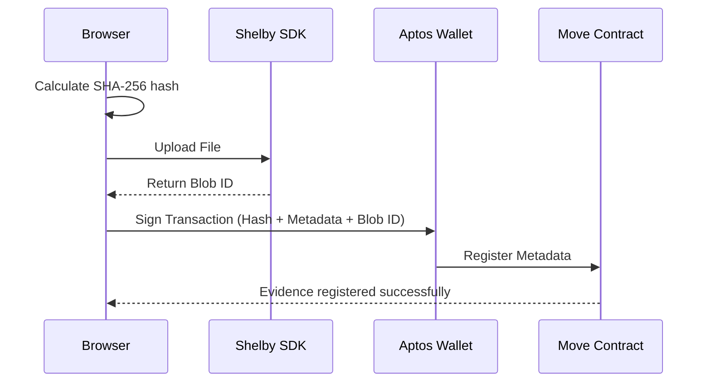

# ProofVault

ProofVault is a verifiable file integrity and storage platform. It allows users to upload documents, datasets, media, and digital records to Shelby decentralized storage and register their file metadata and SHA-256 integrity hash on the Aptos blockchain.

## Problem Statement
In a digital world, verifying the authenticity of documents, media, and datasets is difficult. When sharing important files online, it is challenging to prove that the file was not altered, tampered with, or secretly replaced after it was published.

## Solution
ProofVault stores files through Shelby and registers their publisher, timestamp, storage reference, and integrity hash on Aptos, creating an irrefutable timeline.

## Architecture



## Technology Stack
- Next.js App Router (TypeScript)
- Tailwind CSS
- Aptos TypeScript SDK & Wallet Adapter
- Aptos Move
- Shelby SDK

## Repository Structure
```
proofvault/
├── src/
│   ├── app/ (Next.js Routes)
│   ├── components/ (UI Components)
│   └── lib/ (Aptos & Shelby Integrations)
├── contracts/
│   └── proof_vault/ (Move Smart Contract)
├── public/
└── package.json
```

## Setup Instructions

### 1. Prerequisites
- Node.js 22+
- pnpm
- Aptos CLI

### 2. Local Installation
```bash
pnpm install
```

### 3. Aptos Smart Contract
Compile the contract:
```bash
cd contracts/proof_vault
aptos move compile
```

Run Move unit tests:
```bash
aptos move test
```

Publish to Testnet:
```bash
aptos move publish --named-addresses proof_vault=default
```

### 4. Frontend Configuration
Copy `.env.example` to `.env.local` and set your contract address and Shelby API key.

### 5. Run Development Server
```bash
pnpm dev
```

### 6. Production Build
```bash
pnpm build
```

## Security Considerations
- The original file names are not trusted; a unique blob ID is generated.
- Files are not encrypted in this MVP (visibility is purely logical).
- Integrity is proven by recalculating the SHA-256 hash entirely client-side.
